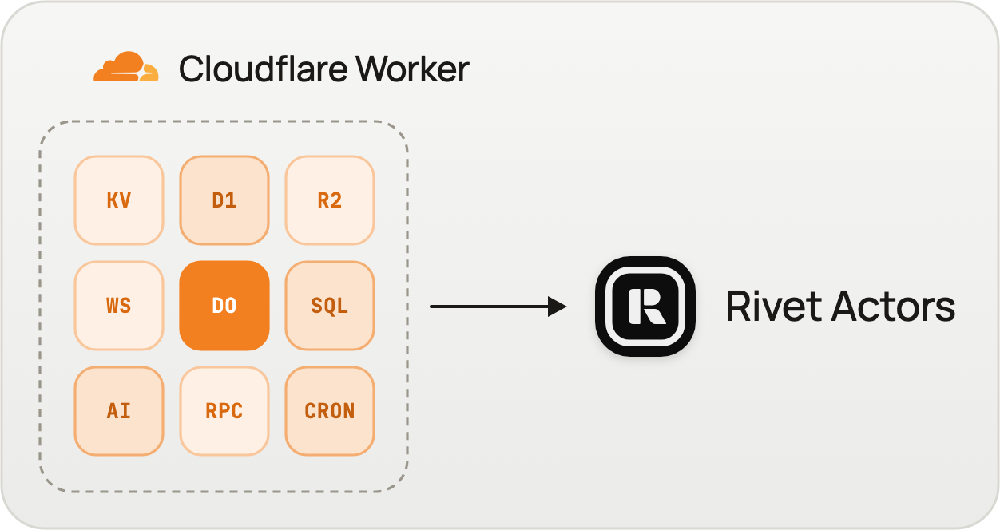
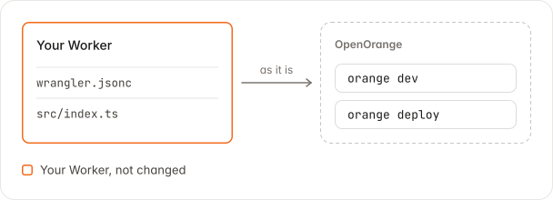
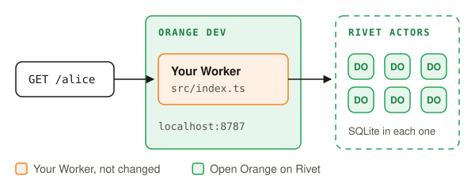
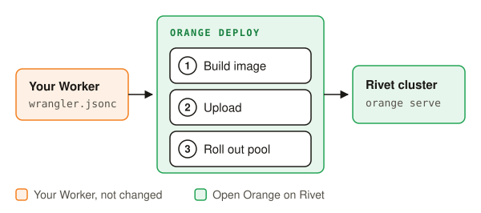
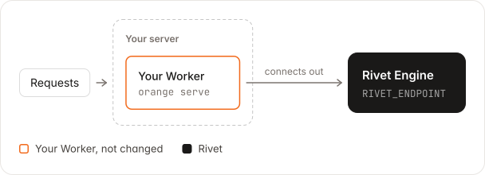
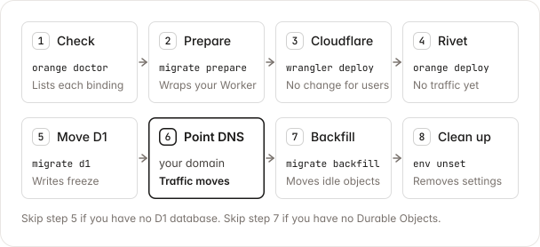
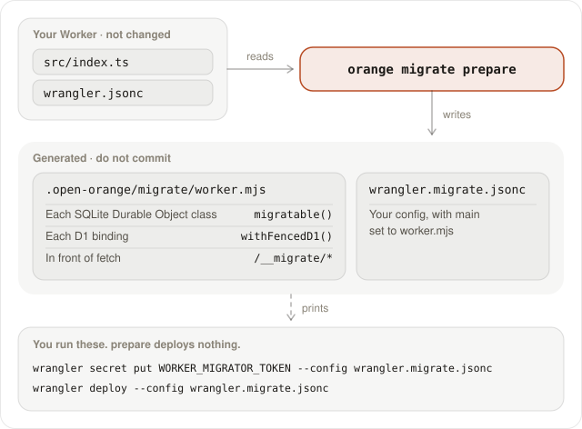
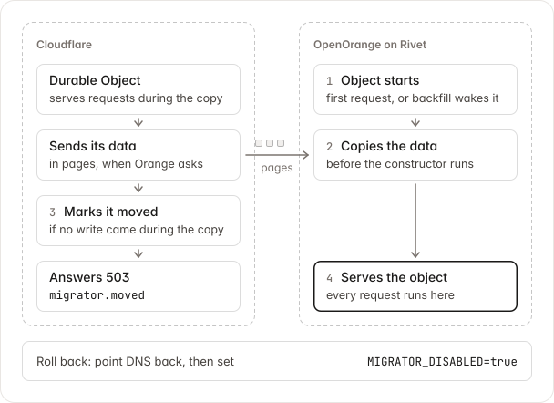
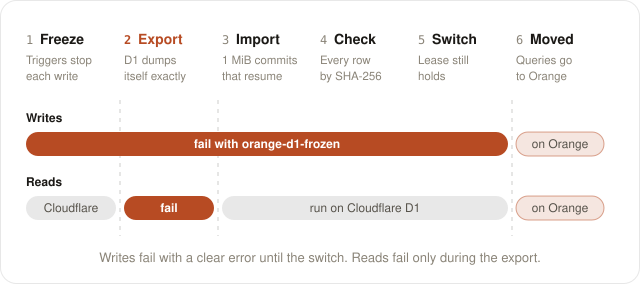

<h1 align="center">
  <a href="https://openorange.dev">
    <picture>
      <source media="(prefers-color-scheme: dark)" srcset="docs/images/readme-logo-dark.svg">
      
    </picture>
  </a>
</h1>

<p align="center"><strong>Run Cloudflare Workers anywhere: AWS, Google Cloud, Azure or your own servers.</strong></p>

<p align="center">
  <a href="https://openorange.dev/docs">Docs</a> ·
  <a href="docs/deploy.mdx">Deploy</a> ·
  <a href="docs/migrate.mdx">Migrate</a> ·
  <a href="docs/modules/bindings.mdx">Bindings</a> ·
  <a href="examples/">Examples</a> ·
  <a href="https://rivet.dev/discord">Discord</a>
</p>

<p align="center">
  
</p>

## What is OpenOrange

OpenOrange runs your existing Cloudflare Workers project, with no changes to your code. You get the same developer experience as Cloudflare, without the runtime limits, for a fraction of the bill. It's built with four goals:

- **Zero refactoring, zero-downtime migration**: your Workers and Durable Objects run as they are, and your data moves off Cloudflare while your app keeps serving.
- **The same developer experience**: `wrangler dev` becomes `orange dev`, and everything underneath is open source and self-hostable.
- **Simpler bills**: you pay for the machines you run on, not Cloudflare's metering or an enterprise contract.
- **Built for scale**: storage is backed by S3 with an SSD layer in front, so scaling out is a matter of adding machines.

Learn more at [openorange.dev](https://openorange.dev).

## Use a coding agent

Paste this into your coding agent (Claude Code, Codex, Cursor, …) from your Worker project:

```text
Move this Cloudflare Worker to Rivet with OpenOrange.

1. Install the CLI with `pnpm add -g open-orange`, run `orange doctor` here,
   and show me what needs setup.
2. Read https://github.com/rivet-dev/open-orange/blob/main/skills/rivet-open-orange/SKILL.md
   and follow it. Ask me before each step that deploys or moves data.
```

## What it does

OpenOrange reads your Wrangler configuration and runs the same Worker on Node.js. Each Durable Object runs as a [Rivet Actor](https://rivet.dev/docs/actors/) with its own SQLite database.

- **Run.** `orange dev` runs your Worker on your machine.
- **Deploy.** `orange deploy` rolls it out to a Rivet cluster. `orange serve` runs it on your own Rivet Engine.
- **Migrate.** `orange migrate` moves your Durable Objects and D1 databases from Cloudflare while your app serves.

See [openorange.dev/docs](https://openorange.dev/docs) for the full docs.

## What runs where

| Cloudflare binding | Runs on | You set |
|---|---|---|
| [Durable Objects](docs/modules/durable-objects.mdx) | One Rivet Actor for each object, with its own SQLite database | Nothing |
| [KV](docs/modules/kv.mdx), [D1](docs/modules/d1.mdx), [Rate Limiting](docs/modules/rate-limiting.mdx), [Cache](docs/modules/cache.mdx) | Rivet Actors | Nothing |
| [Queues](docs/modules/queues.mdx) | One Rivet Actor for each queue | Nothing |
| [Workflows](docs/modules/workflows.mdx) | Cloudflare's own Workflows engine, with one Rivet Actor for each instance | Nothing |
| [Cron Triggers](docs/modules/cron-triggers.mdx) | A Rivet Actor | Nothing |
| [Tail Workers](docs/modules/tail-workers.mdx) | Rivet Durable Streams | Nothing |
| [R2](docs/modules/r2.mdx) | A Rivet Actor, or your S3-compatible store | Nothing, or `ORANGE_R2_<BUCKET>_S3_ENDPOINT` and its access keys for Amazon S3, Cloudflare R2, Google Cloud Storage, or Backblaze B2 |
| [Worker Loader](docs/modules/worker-loader.mdx) | A separate process in an agentOS VM | Nothing |
| [Workers AI](docs/modules/workers-ai.mdx) | An OpenAI-compatible provider | `OPENROUTER_API_KEY`, or `ORANGE_AI_BASE_URL` and `ORANGE_AI_API_KEY` for OpenAI, Groq, Together AI, or Fireworks AI |
| [Send Email](docs/modules/email.mdx) | Your SMTP server | `ORANGE_EMAIL_SMTP_URL`: Amazon SES, Resend, Postmark, SendGrid, or Mailgun |
| [Browser Rendering](docs/modules/browser-rendering.mdx) | A hosted browser, or your Chrome | `ORANGE_BROWSER_CDP_URL`: Browserbase, Browserless, or Steel |
| [Hyperdrive](docs/modules/hyperdrive.mdx) | Your database, with a direct connection | The connection string, as for `wrangler dev`: PlanetScale, Amazon RDS, Neon, or Supabase |
| [Sandbox](docs/modules/sandbox.mdx) | A sandbox provider | `ORANGE_SANDBOX_PROVIDER`: `e2b`, `daytona`, `freestyle`, `agentos`, or `local` (default) |
| Analytics Engine | Nothing. `writeDataPoint()` drops each data point | |
| Vectorize, Images, Media, Stream, Pipelines, AI Search, mTLS certificates, VPC, and legacy blobs | Not supported. Calls throw | |

See the [compatibility matrix](docs/modules/bindings.mdx) for every binding and Wrangler key.

## Quickstart

You need a Worker project with a `wrangler.jsonc`, `wrangler.json`, or `wrangler.toml` (or use [`examples/hello-durable-object`](examples/hello-durable-object)), Node.js 22 or later, pnpm, and Docker to deploy.

### Step 1: Install

<picture>
  <source media="(prefers-color-scheme: dark)" srcset="docs/images/step-1-install-dark.svg">
  
</picture>

```sh
pnpm add -g open-orange
```

Your code and your Wrangler configuration do not change.

### Step 2: Check your Worker

Run this in your Worker project:

```sh
orange doctor
```

It lists each binding as **runs as is**, **needs a service you supply** (with the variable to set), or **not supported**, says which Durable Object classes `orange migrate` can move, and ends with the commands to run next. Add `--json` for a coding agent.

### Step 3: Run your Worker

<picture>
  <source media="(prefers-color-scheme: dark)" srcset="docs/images/step-2-dev-dark.svg">
  
</picture>

```sh
orange dev
```

For a Worker with one Durable Object binding, it prints:

```text
  Binding       Resource         Runs on
  env.COUNTER   Durable Object   Rivet Actor · Counter

● Ready in 4.6s
  Local         http://127.0.0.1:8787
  Agent         Run orange mcp to connect your coding agent to the Rivet MCP
```

The `Agent` row shows until an agent configuration has the Rivet MCP.

Your Worker now answers on `http://localhost:8787`. Its data is in `.open-orange/` and stays there when you restart. Add `.open-orange/` to your `.gitignore`.

### Step 4: Deploy

<picture>
  <source media="(prefers-color-scheme: dark)" srcset="docs/images/step-3-deploy-dark.svg">
  
</picture>

```sh
orange login
orange link --cluster <cluster-name>
orange deploy
```

The command prints the public URL of the runner pool. Your Worker now serves from your Rivet cluster.

Pass variables and secrets with flags:

| Flag | Does |
|---|---|
| `--var NAME:value` | Sets a variable. Replaces a `vars` entry of the same name. |
| `--secret KEY` | Sets `env.KEY` to a secret that the cluster already holds |
| `--secrets-file .dev.vars` | Rolls out each entry of a JSON or `.env` file as a cluster secret |

```sh
orange deploy --secrets-file .dev.vars --var LOG_LEVEL:debug
```

> [!TIP]
> `orange deploy --dry-run` writes the build and prints the plan. It calls no API.

See the [deploy guide](docs/deploy.mdx) for every flag, rollback, and CI tokens.

### Self-host

<picture>
  <source media="(prefers-color-scheme: dark)" srcset="docs/images/self-host-dark.svg">
  
</picture>

`orange serve` runs your Worker against the Rivet Engine in `RIVET_ENDPOINT`. It connects out to the Engine, so the Engine does not need to reach your server.

```sh
RIVET_ENDPOINT=https://<namespace>:<token>@<engine-host> orange serve
```

To run it as a container, write the image that `orange deploy` builds:

```sh
orange deploy --dry-run --outdir out
docker build --platform linux/amd64 -f out/Dockerfile -t my-worker out/context
docker run --rm -p 8080:8080 -e RIVET_ENDPOINT=https://<namespace>:<token>@<engine-host> my-worker
```

## Add the Rivet MCP

Add the Rivet MCP to your agent, then approve the Rivet sign-in.

**Claude Code**

```sh
claude mcp add --transport http rivet "https://mcp.rivet.dev/mcp"
```

**Codex**

```sh
codex mcp add rivet --url https://mcp.rivet.dev/mcp
```

**Cursor** (add to your MCP configuration)

```json
{ "mcpServers": { "rivet": { "url": "https://mcp.rivet.dev/mcp" } } }
```

**VS Code**

```sh
code --add-mcp '{"name":"rivet","type":"http","url":"https://mcp.rivet.dev/mcp"}'
```

For other clients, see [Rivet MCP](https://rivet.dev/mcp). `orange mcp` checks whether your agent has it and prints the command for your linked cluster.

## Migrate

`orange migrate` moves SQLite Durable Objects and D1 databases from Cloudflare while your app serves. Durable Objects need no maintenance window. A D1 database takes no writes while it moves: about 3 minutes per GB in a test. Skip this section if your app has no data on Cloudflare.

<picture>
  <source media="(prefers-color-scheme: dark)" srcset="docs/images/readme-migrate-path-dark.svg">
  
</picture>

1. **Check.** Run `orange doctor`.
2. **Prepare.** Wrap your Cloudflare Worker. Your code does not change.

   ```sh
   orange migrate prepare
   ```

3. **Deploy to Cloudflare.** Deploy the prepared Worker. Your users see no change.

   ```sh
   pnpm wrangler secret put WORKER_MIGRATOR_TOKEN --config wrangler.migrate.jsonc
   pnpm wrangler deploy --config wrangler.migrate.jsonc
   ```

4. **Deploy to Rivet.** Run `orange deploy` with two more settings: `ORANGE_MIGRATE_WORKER_URL`, set to your `workers.dev` URL, and `WORKER_MIGRATOR_TOKEN`, set to the same token.
5. **Move D1.** Run this command for each D1 database. Use the URL that `orange deploy` prints. Its writes fail until the move ends.

   ```sh
   orange migrate d1 <database> --url <orange-url>
   ```

6. **Point DNS.** Point your domain at OpenOrange. Each Durable Object now copies itself from Cloudflare on its first request.
7. **Backfill.** Wait a few minutes, then copy the Durable Objects that got no requests. Run the command again after a few more minutes, because Cloudflare lists new objects late.

   ```sh
   orange migrate backfill --url https://app.example.com
   ```

8. **Clean up.** Remove `ORANGE_MIGRATE_WORKER_URL` after a backfill reports 0 failed. OpenOrange never deletes data on Cloudflare.

Skip step 5 if your app has no D1 database. Skip step 7 if it has no Durable Objects.

`migrate d1` and `migrate backfill` read `ORANGE_MIGRATE_WORKER_URL` and `WORKER_MIGRATOR_TOKEN` from your shell or `.dev.vars`. `migrate backfill` and `migrate d1` also need `CLOUDFLARE_API_TOKEN` and `CLOUDFLARE_ACCOUNT_ID`. See the [migration guide](docs/migrate.mdx) for failures and limits.

### What `orange migrate prepare` does

<picture>
  <source media="(prefers-color-scheme: dark)" srcset="docs/images/readme-migrate-prepare-dark.svg">
  
</picture>

`prepare` writes a Worker that exports your app as it is, with three additions:

- Each SQLite Durable Object class goes through `migratable()`, which lets the object export its data.
- Each D1 binding gets a wrapper that sends its queries to OpenOrange after the database moves.
- The token-protected `/__migrate/*` routes go in front of your `fetch` handler.

`prepare` deploys nothing. It prints the `wrangler` commands, and you run them. Do not commit the two generated files.

### How a Durable Object moves

<picture>
  <source media="(prefers-color-scheme: dark)" srcset="docs/images/readme-migrate-durable-object-dark.svg">
  
</picture>

- An object moves on its first request to OpenOrange, or when `orange migrate backfill` wakes it.
- OpenOrange pulls the data in pages before the object's constructor runs.
- Cloudflare marks the object as moved only if no write came during the copy. If a write came, the copy starts again.
- After that, Cloudflare answers 503 `migrator.moved` for the object, so no write can go to the old copy.

**To roll back,** point your domain back at Cloudflare and set `MIGRATOR_DISABLED=true` on the prepared Worker. Writes made on OpenOrange stay on OpenOrange.

Durable Objects that use the older key-value storage (`new_classes`) cannot move.

### How a D1 database moves

<picture>
  <source media="(prefers-color-scheme: dark)" srcset="docs/images/readme-migrate-d1-dark.svg">
  
</picture>

1. **Freeze.** Triggers on Cloudflare's D1 refuse every write with `orange-d1-frozen`. Reads continue.
2. **Export.** Cloudflare's D1 export API dumps the database exactly. D1 answers no query until it ends.
3. **Import.** OpenOrange reads the dump in commits of about 1 MiB. A rerun continues from the last commit.
4. **Check.** OpenOrange compares every row with the frozen D1, by SHA-256 per page of rows.
5. **Switch.** Cloudflare forwards every query for the database to OpenOrange.

If a step fails before the switch, the freeze opens, Cloudflare takes writes again, and nothing is lost.

## Caveats

- **Not every binding runs.** Vectorize, Images, Media, Stream, Pipelines, AI Search, mTLS certificates, and VPC throw on each call. Analytics Engine drops its writes. Some bindings need a service you supply. See [What runs where](#what-runs-where).
- **WebSocket hibernation is emulated.** The Durable Object leaves memory and its sockets stay open, but its Rivet Actor stays running.
- **Compatibility dates do not apply.** OpenOrange runs one profile and ignores `compatibility_date`. It warns about each flag in `compatibility_flags` that it does not apply.
- **KV-backed Durable Objects cannot move.** Only SQLite Durable Objects (`new_sqlite_classes`) move with `orange migrate`.
- **A D1 database takes no writes while it moves,** about 3 minutes per GB in a test.
- **Cloudflare keeps your data.** OpenOrange never deletes anything on Cloudflare. Delete the Worker and its data yourself after the move.
- **Upstream workerd tests:** 1,602 of 1,774 pass (90.3%). See the [report](packages/cloudflare-conformance/README.md).

Each [module page](docs/modules/index.mdx) lists every known difference from Cloudflare.

## Commands

`orange`, `open-orange`, and `openorange` are the same command.

| Command | Does |
|---|---|
| `orange dev` | Runs the Worker on your machine |
| `orange doctor` | Checks the project, reports its bindings (not its variables) and Durable Object classes, and prints the next commands |
| `orange mcp` | Says whether your coding agent has the Rivet MCP, and prints the command that connects it |
| `orange login` | Signs in to Rivet Cloud |
| `orange link --cluster <name>` | Links this directory to a Rivet cluster |
| `orange deploy` | Builds an image and rolls it out to a Rivet cluster |
| `orange serve` | Serves the Worker against the Rivet Engine in `RIVET_ENDPOINT` |
| `orange migrate prepare` | Writes the Worker and Wrangler configuration that you deploy to Cloudflare for the move |
| `orange migrate backfill --url <url>` | Copies every Durable Object that got no requests |
| `orange migrate d1 <database> --url <url>` | Moves a D1 database with Cloudflare's export API. Its writes fail until the move ends. |
| `orange types` | Generates `worker-configuration.d.ts` |
| `orange d1 execute <database>` | Runs SQL against a local D1 database |

Run `orange <command> --help` for the flags of one command.

## Resources

- [Deploy guide](docs/deploy.mdx): variables, secrets, rollback, and self-hosting.
- [Migration guide](docs/migrate.mdx): how to cut over, how to roll back, and what cannot move.
- [Modules](docs/modules/index.mdx): one page for each binding and runtime API, with its known differences.
- [Examples](examples/): Workers that you can copy, with no OpenOrange imports.
- [Real projects](packages/cloudflare-conformance/real-projects): open-source Workers run through `orange dev`, with what works and what does not.
- [Discord](https://rivet.dev/discord): questions and support.

## Contributing

```sh
git clone https://github.com/rivet-dev/open-orange
cd open-orange
pnpm install
pnpm orange --help   # runs the CLI from source
pnpm typecheck
pnpm test
```

## License

[Apache-2.0](LICENSE)
