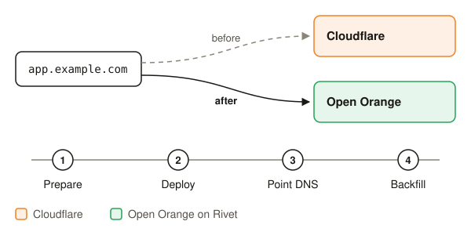
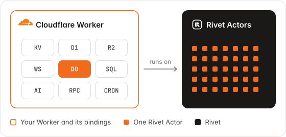

<h1 align="center">
  <a href="https://openorange.dev">
    <picture>
      <source media="(prefers-color-scheme: dark)" srcset="docs/images/readme-logo-dark.svg">
      
    </picture>
  </a>
</h1>

<p align="center"><strong>Run Cloudflare Workers anywhere.</strong></p>

<p align="center">The same developer experience, without the runtime limits, for a fraction of the bill.</p>

<p align="center">
  <a href="https://openorange.dev/docs/">Docs</a> ·
  <a href="https://openorange.dev/docs/deploy/">Deploy</a> ·
  <a href="https://openorange.dev/docs/migrate/">Migrate</a> ·
  <a href="https://openorange.dev/docs/bindings/">Bindings</a> ·
  <a href="examples/">Examples</a> ·
  <a href="https://rivet.dev/discord">Discord</a>
</p>

## What is OpenOrange

OpenOrange runs your existing Cloudflare Workers project on AWS, Google Cloud, Azure or your own servers, with no changes to your code. It's built with four goals:

- **Zero refactoring, zero-downtime migration**: your Workers and Durable Objects run as they are, and your data moves off Cloudflare while your app keeps serving.
- **The same developer experience**: `wrangler dev` becomes `orange dev`, and everything underneath is open source and self-hostable.
- **Simpler bills**: you pay for the machines you run on, not Cloudflare's metering or an enterprise contract. Compute is 4.8× cheaper and storage 8.7× cheaper.
- **Built for scale**: storage is backed by S3, so scaling out is a matter of adding machines.

## Quickstart

You need a Worker project with a `wrangler.jsonc`, `wrangler.json`, or `wrangler.toml` (or use [`examples/hello-durable-object`](examples/hello-durable-object)), Node.js 22 or later, and pnpm. Deploying also needs Docker.

### Step 1: Install

Install the `orange` CLI globally, then run it in your Worker project. Your code and your Wrangler configuration do not change.

```sh
pnpm add -g open-orange
```

### Step 2: Run your Worker

Your Worker answers on `http://localhost:8787`. Each Durable Object runs as a Rivet Actor with its own SQLite database, kept in `.open-orange/`.

```sh
$ orange dev
  Binding       Resource         Runs on
  env.COUNTER   Durable Object   Rivet Actor · Counter

● Ready in 4.6s
  Local         http://127.0.0.1:8787
```

### Step 3: Deploy

`orange deploy` builds an image of your Worker and rolls it out to a Rivet cluster, then prints its public URL.

```sh
$ orange login
$ orange link --cluster <cluster-name>
$ orange deploy
✓ Deployed my-worker
  URL     https://api.example.com
```

See the [deploy guide](https://openorange.dev/docs/deploy/), or [self-host it](#self-host).

### Use a coding agent

Paste this into your coding agent (Claude Code, Codex, Cursor, …) from your Worker project:

```text
Run this project's Cloudflare Worker on Rivet with OpenOrange. First, ask me where it should run: on my machine, on a Rivet cluster, or on my own Rivet Engine. Then read https://github.com/rivet-dev/open-orange/blob/main/README.md and follow its quickstart. Do not change my app code.
```

## Run it where you want

Next to your database, in the cloud and region you choose.

| | Rivet Cloud | BYOC | Self-hosted |
|---|---|---|---|
| | Fully managed | Your cloud, our ops | Open source, Apache 2.0 |
| **Runs on** | A dedicated cluster on AWS or Google Cloud, in the region you choose | Your AWS, Google Cloud or Azure account | Any cloud, Hetzner, on-prem or air-gapped |
| **Operated by** | Rivet | Rivet, over an outbound connection | You |

Pass variables and secrets with flags:

| Flag | Does |
|---|---|
| `--var NAME:value` | Sets a variable. Replaces a `vars` entry of the same name. |
| `--secret KEY` | Sets `env.KEY` to a secret that the cluster already holds |
| `--secrets-file .dev.vars` | Rolls out each entry of a JSON or `.env` file as a cluster secret |

```sh
orange deploy --secrets-file .dev.vars --var LOG_LEVEL:debug
```

> [!TIP]
> `orange deploy --dry-run` writes the build and prints the plan. It calls no API.

### Self-host

`orange serve` runs your Worker against the Rivet Engine in `RIVET_ENDPOINT`. It connects out to the Engine, so the Engine does not need to reach your server.

```sh
RIVET_ENDPOINT=https://<namespace>:<token>@<engine-host> orange serve
```

To run it as a container, write the image that `orange deploy` builds:

```sh
orange deploy --dry-run --outdir out
docker build --platform linux/amd64 -f out/Dockerfile -t my-worker out/context
docker run --rm -p 8080:8080 -e RIVET_ENDPOINT=https://<namespace>:<token>@<engine-host> my-worker
```

The Rivet Engine is the control plane: run it once, then run as many Worker containers as you need. See [self-hosting](https://openorange.dev/docs/deploy/#self-host) for the control plane and worker nodes on each platform.

## Same work, a fraction of the bill

Cloudflare's meters, priced on raw AWS: Graviton EC2 in us-east-1 with 40% headroom, and S3 in your account. See [the cost model](https://openorange.dev/#cost).

| | Cloudflare | OpenOrange | |
|---|---|---|---|
| Durable Object compute | $0.045 per GB-hour | $0.0094 per GB-hour | **4.8× cheaper** |
| Durable Object storage | $0.20 per GB-month | $0.023 per GB-month | **8.7× cheaper** |
| SQLite writes | $1.00 per million rows | about $0.18 per million | **5.7× cheaper** |

No egress tax inside your VPC, and your AWS, Google Cloud and Azure credits pay for it.

## No runtime limits

128 MB is all the memory a Cloudflare Worker gets. OpenOrange runs your Workers and Durable Objects on machines you choose, so the limits are your hardware's.

| Limit | Cloudflare Workers Paid | OpenOrange |
|---|---|---|
| Memory per Worker or Durable Object | 128 MB | Up to your machine's memory. The Node.js heap is up to about 4 GB by default, and configurable. |
| CPU time per request | 30 s default, 5 min max | No cap |
| Cron, queue and alarm handlers | 15 min wall time | No cap |
| Open connections per request | 6 at once | OS limits |
| Storage per Durable Object | 10 GB | No cap |
| Worker bundle | 64 MiB | No cap |
| Node.js | `nodejs_compat` subset | Stock Node.js |

Cloudflare values are from its [limits docs](https://developers.cloudflare.com/workers/platform/limits/). Rivet's own limits are mostly soft limits you can raise: see [Limits](https://openorange.dev/docs/operations/limits/).

## Don't sacrifice your DX

Your `wrangler.jsonc` stays the source of truth. Same commands, new name.

| Wrangler | OpenOrange |
|---|---|
| `wrangler dev` | `orange dev` |
| `wrangler deploy -e staging` | `orange deploy -e staging` |
| `wrangler deploy --dry-run` | `orange deploy --dry-run` |

`orange doctor` checks your project: it lists each binding as **runs as is**, **needs a service you supply** (with the variable to set), or **not supported**, says which Durable Object classes `orange migrate` can move, and prints the commands to run next. Add `--json` for a coding agent.

### Commands

`orange`, `open-orange`, and `openorange` are the same command.

| Command | Does |
|---|---|
| `orange dev` | Runs the Worker on your machine |
| `orange doctor` | Checks the project, reports its bindings (not its variables) and Durable Object classes, and prints the next commands |
| `orange mcp` | Says whether your coding agent has the Rivet MCP, and prints the command that connects it |
| `orange login` | Signs in to Rivet Cloud |
| `orange link --cluster <name>` | Links this directory to a Rivet cluster |
| `orange deploy` | Builds an image and rolls it out to a Rivet cluster |
| `orange serve` | Serves the Worker against the Rivet Engine in `RIVET_ENDPOINT` |
| `orange migrate prepare` | Writes the Worker and Wrangler configuration that you deploy to Cloudflare for the move |
| `orange migrate backfill --url <url>` | Copies every Durable Object that got no requests |
| `orange migrate d1 <database> --url <url>` | Moves a D1 database with Cloudflare's export API. Its writes fail until the move ends. |
| `orange types` | Generates `worker-configuration.d.ts` |
| `orange d1 execute <database>` | Runs SQL against a local D1 database |

Run `orange <command> --help` for the flags of one command.

## Migrate your data without downtime

**Durable Objects move with zero downtime.** After you point your domain at OpenOrange, each object copies itself from Cloudflare on its first request, and a backfill copies the rest. Your app keeps serving the whole time. A D1 database takes no writes while it moves: about 3 minutes per GB in a test. Skip this section if your app has no data on Cloudflare.

<picture>
  <source media="(prefers-color-scheme: dark)" srcset="docs/images/step-4-migrate-dark.svg">
  
</picture>

You need a Rivet cluster where `orange deploy` works, your Worker's `workers.dev` URL, a long random `WORKER_MIGRATOR_TOKEN`, and a Cloudflare API token (Workers read, D1 edit) with your account ID. Set `ORANGE_MIGRATE_WORKER_URL`, `WORKER_MIGRATOR_TOKEN`, `CLOUDFLARE_API_TOKEN` and `CLOUDFLARE_ACCOUNT_ID` in your shell or `.dev.vars`.

1. **Check.** Run `orange doctor`. It lists each Durable Object class that `orange migrate` can move.
2. **Prepare.** Wrap your Worker. Your code does not change.

   ```sh
   orange migrate prepare
   ```

3. **Deploy to Cloudflare.** Deploy the prepared Worker. Your users see no change.

   ```sh
   wrangler secret put WORKER_MIGRATOR_TOKEN --config wrangler.migrate.jsonc
   wrangler deploy --config wrangler.migrate.jsonc
   ```

4. **Deploy to Rivet.** Deploy the same app with your Worker's URL and the same token. OpenOrange gets no traffic yet.

   ```sh
   rivet cluster secret set WORKER_MIGRATOR_TOKEN
   orange deploy \
     --var ORANGE_MIGRATE_WORKER_URL:https://my-app.acme.workers.dev \
     --secret WORKER_MIGRATOR_TOKEN
   ```

5. **Move D1.** Run this once for each D1 database, at a quiet time. Use the URL that `orange deploy` prints.

   ```sh
   orange migrate d1 DB --url https://<orange-url>
   ```

6. **Point DNS.** Point your domain at OpenOrange. Each Durable Object copies itself from Cloudflare on its first request.
7. **Backfill.** A few minutes later, copy the objects that got no request. Run it again, a few minutes apart, until every class prints `0 moved, 0 failed`.

   ```sh
   orange migrate backfill --url https://my-app.example.com
   ```

8. **Clean up.** When no traffic reaches Cloudflare and a backfill reports 0 failed, turn the migration off. OpenOrange never deletes data on Cloudflare.

   ```sh
   rivet cluster env unset ORANGE_MIGRATE_WORKER_URL --pool <pool>
   ```

Skip step 5 if your app has no D1 database. Skip step 7 if it has no Durable Objects. See the [migration guide](https://openorange.dev/docs/migrate/) for cron triggers, rollback, and what cannot move.

### What `orange migrate prepare` does

<picture>
  <source media="(prefers-color-scheme: dark)" srcset="docs/images/readme-migrate-prepare-dark.svg">
  
</picture>

`prepare` writes a Worker that exports your app as it is, with three additions:

- Each SQLite Durable Object class goes through `migratable()`, which lets the object export its data.
- Each D1 binding gets a wrapper that sends its queries to OpenOrange after the database moves.
- The token-protected `/__migrate/*` routes go in front of your `fetch` handler.

`prepare` deploys nothing. It prints the `wrangler` commands, and you run them. Do not commit the two generated files.

### How a Durable Object moves

<picture>
  <source media="(prefers-color-scheme: dark)" srcset="docs/images/readme-migrate-durable-object-dark.svg">
  
</picture>

- An object moves on its first request to OpenOrange, or when `orange migrate backfill` wakes it.
- OpenOrange pulls the data in pages before the object's constructor runs.
- Cloudflare marks the object as moved only if no write came during the copy. If a write came, the copy starts again.
- After that, Cloudflare answers 503 `migrator.moved` for the object, so no write can go to the old copy.

**To roll back,** point your domain back at Cloudflare and set `MIGRATOR_DISABLED=true` on the prepared Worker. Writes made on OpenOrange stay on OpenOrange.

Durable Objects that use the older key-value storage (`new_classes`) cannot move.

### How a D1 database moves

<picture>
  <source media="(prefers-color-scheme: dark)" srcset="docs/images/readme-migrate-d1-dark.svg">
  
</picture>

1. **Freeze.** Triggers on Cloudflare's D1 refuse every write with `orange-d1-frozen`. Reads continue.
2. **Export.** Cloudflare's D1 export API dumps the database exactly. D1 answers no query until it ends.
3. **Import.** OpenOrange reads the dump in commits of about 1 MiB. A rerun continues from the last commit.
4. **Check.** OpenOrange compares every row with the frozen D1, by SHA-256 per page of rows.
5. **Switch.** Cloudflare forwards every query for the database to OpenOrange.

If a step fails before the switch, the freeze opens, Cloudflare takes writes again, and nothing is lost.

## How it works

OpenOrange is powered by [Rivet](https://rivet.dev), a scalable control plane that runs your Cloudflare workloads. Your code ships as standard Docker containers, so it runs anywhere Docker runs. See [Architecture](https://openorange.dev/docs/architecture/).

### Powered by Rivet, backed by S3

Rivet is an open-source control plane. Each Durable Object runs as a [Rivet Actor](https://rivet.dev/actors/docs/): Rivet finds it, wakes it on one of your containers, and routes each request to it. Rivet keeps state in S3, which is cheap, durable and scalable. Scaling out is a matter of adding machines.

### Standard Docker containers, in any cloud

`orange deploy` builds your Worker and the OpenOrange runtime into a standard Docker image. Each container holds your Workers, Durable Objects, Workflows and the rest of your Cloudflare code, and connects out to Rivet, which spreads the load across them. To add capacity, add containers.

### Each binding maps to the best-fit service

Your bindings and your code stay the same. Stateful bindings run on Rivet Actors. The rest plug into services you already use.

<p align="center">
  <picture>
    <source media="(prefers-color-scheme: dark)" srcset="docs/images/hero-dark.svg">
    
  </picture>
</p>

| Cloudflare binding | Status | Runs on |
|---|---|---|
| [Durable Objects](https://openorange.dev/docs/bindings/durable-objects/) | Partial | One Rivet Actor for each object, with its own SQLite database |
| [KV](https://openorange.dev/docs/bindings/kv/), [D1](https://openorange.dev/docs/bindings/d1/), [Rate Limiting](https://openorange.dev/docs/bindings/rate-limiting/) | Drop-in | Rivet Actors |
| [Cache](https://openorange.dev/docs/bindings/cache/) | Partial | One Rivet Actor for each cache name |
| [Queues](https://openorange.dev/docs/bindings/queues/) | Drop-in | One Rivet Actor for each queue |
| [Workflows](https://openorange.dev/docs/bindings/workflows/) | Partial | Cloudflare's own Workflows engine, with one Rivet Actor for each instance |
| [Cron Triggers](https://openorange.dev/docs/bindings/cron-triggers/) | Drop-in | A Rivet Actor |
| [Tail Workers](https://openorange.dev/docs/bindings/tail-workers/) | Partial | Rivet Durable Streams |
| [R2](https://openorange.dev/docs/bindings/r2/) | Pluggable | A Rivet Actor, or Amazon S3, Google Cloud Storage, Cloudflare R2 or MinIO |
| [Worker Loader](https://openorange.dev/docs/bindings/worker-loader/) | Partial | A separate process in an agentOS VM |
| [Workers AI](https://openorange.dev/docs/bindings/workers-ai/) | Pluggable | OpenRouter, OpenAI, or any OpenAI-compatible endpoint |
| [Send Email](https://openorange.dev/docs/bindings/email/) | Pluggable | Amazon SES, or any SMTP server |
| [Browser Rendering](https://openorange.dev/docs/bindings/browser-rendering/) | Pluggable | Browserbase, or any Chrome DevTools endpoint |
| [Hyperdrive](https://openorange.dev/docs/bindings/hyperdrive/) | Drop-in | Your Postgres or MySQL database, with a direct connection |
| [Sandbox](https://openorange.dev/docs/bindings/sandbox/) | Pluggable | E2B, Daytona, Freestyle, agentOS, or a local directory |
| Analytics Engine | Not supported | `writeDataPoint()` drops each data point |
| Vectorize, Images, Media, Stream, Pipelines, AI Search, mTLS certificates, VPC, and legacy blobs | Not supported | Calls throw |

**Drop-in** runs as on Cloudflare. **Pluggable** runs on a provider you configure. **Partial** runs with known differences, listed on each binding's page. See [binding configuration](https://openorange.dev/docs/bindings/configuration/) for every Wrangler key and the variables each provider needs, and [Compatibility](https://openorange.dev/docs/compatibility/) for the test results.

### Real Node.js, not the Workers runtime

Your Worker runs in a Node.js process, so you're not limited to the part of Node.js that the Workers runtime supports. Node.js APIs are always on, without `nodejs_compat`, and the machines you choose set the memory and CPU time. That opens up npm packages that need Node.js APIs the Workers runtime doesn't have.

## Questions

**Wait, wasn't Cloudflare supposed to be cheaper?** For small, spiky Workers, it often is: the free tier and per-request pricing are hard to beat. The meters add up once Durable Objects stay busy. The same GB-hours on Graviton EC2 cost about a fifth as much, and writes cost a fraction of that.

**Is OpenOrange a fork of Cloudflare?** No. OpenOrange implements the Workers API on Node.js and maps each Cloudflare service onto Rivet. It uses Wrangler to read your configuration, and it reuses some MIT-licensed Cloudflare code, such as the Workflows engine. It does not run workerd.

**Why not just run workerd directly?** workerd is Cloudflare's runtime, not its platform. KV, D1, R2, Queues, Workflows and the Cache API are bindings that call services you have to build, and Durable Objects keep their data on one machine with nothing to place, replicate or scale them. See [OpenOrange vs workerd](https://openorange.dev/vs-workerd/).

**Do I need to learn Rivet?** No. Rivet is the control plane underneath. You use the `orange` CLI and your Wrangler configuration.

**What does it cost?** OpenOrange is Apache 2.0 and free. Self-host Rivet and your cloud bill is the only bill. Rivet Cloud and BYOC pricing is at [rivet.dev/pricing](https://rivet.dev/pricing).

**What happens to the data already in KV, Durable Objects and R2?** `orange migrate` moves Durable Objects while your app serves, with no downtime. D1 databases are interrupted for a few minutes while they copy. R2 is S3-compatible, so `rclone` or `aws s3 sync` moves buckets.

**Does it run at the edge?** It runs wherever you deploy it, in as many regions as you want. Most backends talk to one database, and running next to it is faster than running at the edge.

**Who maintains OpenOrange?** [Rivet](https://rivet.dev). OpenOrange is not affiliated with or endorsed by Cloudflare, Inc.

## Compare

- [OpenOrange vs Cloudflare Durable Objects](https://openorange.dev/vs-durable-objects/): limits, latency, residency, and moving off.
- [OpenOrange vs workerd](https://openorange.dev/vs-workerd/): a runtime for one Worker, versus your whole app in production.
- [OpenOrange vs celld](https://openorange.dev/vs-celld/): runtime limits, live migration, integrations, and support.
- [OpenOrange vs Rivet](https://openorange.dev/vs-rivet/): when to use Rivet directly, and how to combine them.
- [OpenOrange vs Miniflare](https://openorange.dev/vs-miniflare/): a local simulator, versus production.

## Add the Rivet MCP

Add the Rivet MCP to your agent, then approve the Rivet sign-in.

**Claude Code**

```sh
claude mcp add --transport http rivet "https://mcp.rivet.dev/mcp"
```

**Codex**

```sh
codex mcp add rivet --url https://mcp.rivet.dev/mcp
```

**Cursor** (add to your MCP configuration)

```json
{ "mcpServers": { "rivet": { "url": "https://mcp.rivet.dev/mcp" } } }
```

**VS Code**

```sh
code --add-mcp '{"name":"rivet","type":"http","url":"https://mcp.rivet.dev/mcp"}'
```

For other clients, see [Rivet MCP](https://rivet.dev/docs/mcp/). `orange mcp` checks whether your agent has it and prints the command for your linked cluster.

## Caveats

- **Not every binding runs.** Vectorize, Images, Media, Stream, Pipelines, AI Search, mTLS certificates, and VPC throw on each call. Analytics Engine drops its writes. Some bindings need a service you supply. See [What runs where](#each-binding-maps-to-the-best-fit-service).
- **Compatibility dates do not apply.** OpenOrange runs one profile and ignores `compatibility_date`. It warns about each flag in `compatibility_flags` that it does not apply.
- **KV-backed Durable Objects cannot move.** Only SQLite Durable Objects (`new_sqlite_classes`) move with `orange migrate`.
- **A D1 database takes no writes while it moves,** about 3 minutes per GB in a test.
- **Cloudflare keeps your data.** OpenOrange never deletes anything on Cloudflare. Delete the Worker and its data yourself after the move.
- **Upstream workerd tests:** 1,602 of 1,774 pass (90.3%). See [Compatibility](https://openorange.dev/docs/compatibility/) and the [conformance report](packages/cloudflare-conformance/README.md).

Each [binding page](https://openorange.dev/docs/bindings/) lists every known difference from Cloudflare.

## Resources

- [Deploy guide](https://openorange.dev/docs/deploy/): Rivet Cloud, self-hosting, variables, secrets, and rollback.
- [Migration guide](https://openorange.dev/docs/migrate/): how to cut over, how to roll back, and what cannot move.
- [Bindings](https://openorange.dev/docs/bindings/): one page for each binding and runtime API, with its known differences.
- [Architecture](https://openorange.dev/docs/architecture/): how OpenOrange runs your Worker on Rivet.
- [Examples](examples/): Workers that you can copy, with no OpenOrange imports.
- [Real projects](packages/cloudflare-conformance/real-projects): open-source Workers run through `orange dev`, with what works and what does not.
- [Discord](https://rivet.dev/discord): questions and support.

## Contributing

```sh
git clone https://github.com/rivet-dev/open-orange
cd open-orange
pnpm install
pnpm orange --help   # runs the CLI from source
pnpm typecheck
pnpm test
```

OpenOrange's compatibility contract is tested three ways, in [`packages/cloudflare-conformance`](packages/cloudflare-conformance):

- **Types.** OpenOrange's runtime is type-checked against Cloudflare's pinned Workers declarations.
- **Behavior.** Differential tests run the same Worker on Cloudflare and on OpenOrange, plus workerd's own upstream test suite.
- **Real projects.** Open-source Workers run through `orange dev`, with what works and what does not.

[`CLAUDE.md`](CLAUDE.md) is the contributor guide.

## License

[Apache-2.0](LICENSE)
