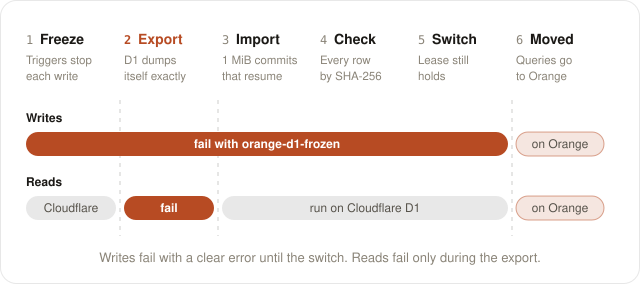
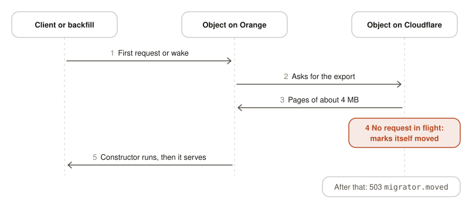

# Migrate from Cloudflare

`orange migrate` moves Durable Objects and D1 databases from Cloudflare to Orange.
Your app serves during the move, and your app code does not change.

- A Durable Object moves when it first gets a request on Orange. A backfill moves the rest.
- A D1 database moves with one command, through Cloudflare's D1 export API. Its writes fail with a
  clear error from the start of the move until the switch, and none is lost.
- Orange never deletes anything on Cloudflare.

The Durable Object move uses
[`@rivet-dev/durable-object-migrator`](https://github.com/rivet-dev/durable-object-migrator).

## What moves

| Data | On Orange |
|---|---|
| Durable Object SQL tables, rowids, indexes, triggers, views, and `AUTOINCREMENT` counters | The same, through `ctx.storage.sql` |
| Durable Object KV values, including `Date`, `Map`, and `BigInt` | The same, through `ctx.storage.get()` and `ctx.storage.kv` |
| A pending alarm | Scheduled on Orange, and removed on Cloudflare |
| IDs from `idFromName()` | The object keeps its name. Its ID string on Orange differs. |
| IDs from `newUniqueId()` | The same ID string. An app can keep the IDs it stored. |
| D1 tables, indexes, views, triggers, and `AUTOINCREMENT` counters | The same, through the D1 binding |
| D1 values: 64-bit integers, REALs including subnormals and infinities, BLOBs, and TEXT | Copied exactly, and checked row by row before the switch |

## What does not move

| Item | What happens |
|---|---|
| KV-backed Durable Object classes (`new_classes`) | `orange migrate prepare` fails with an error that names the class, and writes nothing. Cloudflare gives these classes no way to export. `orange doctor` lists each such class before you start. |
| Durable Object classes without a binding | `prepare` stops with an error. The migrator reaches an object through its binding. |
| Classes from `transferred_classes` that were KV-backed | The config does not show the backend of a transferred class, so `prepare` and `doctor` treat it as SQLite-backed, as Orange does. Make sure that the class was SQLite-backed in the Worker it came from. |
| Durable Object virtual tables, such as FTS5 | The export of that object fails. |
| Durable Object SQL that Orange's SQLite cannot run | A `CHECK` constraint or a generated column that uses a math function, such as `sqrt()`, fails the import of that object. A trigger or view that uses one copies, and fails when it runs. A trigger with `DELETE ... LIMIT` fails the import. |
| Durable Objects in a jurisdiction | The object fails to start on Orange. |
| Facets | Not exported. The parent object moves without them. |
| D1 virtual tables, such as FTS5 | D1's export cannot include them. `orange migrate d1` stops before it changes anything. Drop them on Cloudflare, move, and create them again on Orange. |
| D1 TEXT with invalid UTF-8 or a NUL character | D1's export changes it. The check before the switch finds the row, and the move stops. |
| D1 REAL `-0.0` | D1's export writes it as `0.0`. SQLite compares the two as equal, and the check does not see the sign. |
| The rowid of a D1 table without `INTEGER PRIMARY KEY` | D1's export numbers the rows again from 1, in the same order. `orange migrate d1` warns about each such table whose rowids have gaps. |
| Other bindings that hold data: KV namespaces, R2 buckets, Vectorize indexes, Queues, Workflows, Analytics Engine datasets, Secrets Store secrets, Pipelines, and AI Search | `orange migrate` does not move them. `prepare` names each one in a `Not moved:` line. Copy their data yourself. |
| Writes made on Orange after a move | They stay on Orange. Nothing syncs back to Cloudflare. |

## Before you start

Check each item before step 1.

- [ ] The app runs on Orange. `orange doctor` passes, and `orange dev` serves the app.
- [ ] Each Durable Object class to move is in `new_sqlite_classes` and has a binding in `durable_objects.bindings`.
- [ ] Wrangler bundles the Worker. `prepare` refuses a config with `no_bundle`.
- [ ] You can deploy the Worker with `wrangler deploy`, and you can set a secret on it.
- [ ] You have a Rivet cluster, and `orange deploy` works. See [Deploy](./deploy).
- [ ] You know a URL that reaches the Cloudflare Worker after your domain moves, such as its `workers.dev` URL.
- [ ] Cloudflare can reach the URL of the Orange deployment. The D1 move needs this.
- [ ] You have a long random value for `WORKER_MIGRATOR_TOKEN`.
- [ ] For the backfill, you have a Cloudflare API token with a Workers read permission, and your account ID.
- [ ] For the D1 move, you have a Cloudflare API token with D1 edit permission, and your account ID.
- [ ] The DNS TTL of your domain is low. A client with stale DNS gets errors for moved objects until its DNS updates.

### Test Orange before the migration is on

A request that starts a Durable Object on a deployed Orange before step 4 leaves data on Orange,
even a read, when the constructor writes, such as a `CREATE TABLE IF NOT EXISTS`.
After step 4, that object does not copy itself from Cloudflare: its calls fail with
`has data on Orange that did not come from this migration`, and each backfill run fails on it.

| Safe before step 4 | Not safe before step 4 |
|---|---|
| `orange dev` on your machine. Its data is local. | A request to the deployed Orange that reaches a Durable Object that also exists on Cloudflare, such as an `idFromName("global")` singleton |
| Requests to routes that use no Durable Object | A cron trigger on the deployed Orange that reaches such an object. See [Cron triggers](#cron-triggers). |
| Durable Objects with names or IDs that Cloudflare never had and that production never uses | |

If this happened, destroy the Durable Object actors on Orange before step 4. Until the migration
is on, they hold only test data. Use the Rivet Engine API. `<engine-host>`, `<namespace>`, and the
token are the parts of `RIVET_ENDPOINT`:

```sh
# The actor names of a class start with the class name in kebab case, such as room-1a2b3c4d.
curl -H "authorization: Bearer $RIVET_TOKEN" "https://<engine-host>/actors/names?namespace=<namespace>"
curl -H "authorization: Bearer $RIVET_TOKEN" "https://<engine-host>/actors?namespace=<namespace>&name=<actor-name>"
curl -X DELETE -H "authorization: Bearer $RIVET_TOKEN" "https://<engine-host>/actors/<actor_id>?namespace=<namespace>"
```

After step 4, destroy only the actors whose calls fail with that message. The next request to the
object starts a new actor, which copies the object from Cloudflare.

### Cron triggers

Orange runs the Worker's `triggers.crons` from its first deploy, next to Cloudflare. Until your
domain moves, both run each cron, so a side effect such as an email happens twice. After step 4,
a cron on Orange that reaches a Durable Object also moves that object off Cloudflare, and
Cloudflare then answers its users' requests with `migrator.moved`.

Run each cron in one place at a time:

1. Deploy to Orange with `--var ORANGE_CRONS:off` until step 6. Orange then runs no cron and deletes the jobs of crons that it ran before.
2. In step 6, when your domain points at Orange, remove the cron triggers of the Worker on Cloudflare, in the Cloudflare dashboard under the Worker's settings. A later `wrangler deploy` of a config with `triggers.crons` adds them back.
3. Then turn the crons on in Orange: `rivet cluster env unset ORANGE_CRONS --pool <pool>`. This rolls the pool.

`orange dev` runs crons too. Put `ORANGE_CRONS=off` in `.dev.vars` to stop them.

## Steps at a glance

| # | Step | Command | What users see |
|---|---|---|---|
| 1 | [Check the project](#1-check-the-project) | `orange doctor` | No change |
| 2 | [Prepare the Worker](#2-prepare-the-worker) | `orange migrate prepare` | No change. Nothing is deployed. |
| 3 | [Deploy the prepared Worker](#3-deploy-the-prepared-worker-to-cloudflare) | `wrangler deploy --config wrangler.migrate.jsonc` | No change |
| 4 | [Deploy to Rivet](#4-deploy-to-rivet) | `orange deploy` | No change. Orange has no traffic yet. |
| 5 | [Move D1 databases](#5-move-d1-databases) | `orange migrate d1` | Writes fail until the switch. All queries fail during the export, about 47 s per GB. |
| 6 | [Point your domain at Orange](#6-point-your-domain-at-orange) | Your DNS provider | The first request to each object waits while the object copies. |
| 7 | [Backfill](#7-backfill-the-durable-objects) | `orange migrate backfill` | No change |
| 8 | [Clean up](#8-clean-up) | `rivet cluster env unset` | No change |

Skip step 5 if the Worker has no D1 database.
Skip step 7 if the Worker has no Durable Objects.

Move the D1 databases before you point your domain at Orange. Until a database moves, the
database on Orange is empty.

## 1. Check the project

```sh
orange doctor
```

`doctor` checks Node.js, RivetKit, the Wrangler config, the bundle, and the port. It reports
each binding as runs as is, needs a service, or not supported, and lists each Durable Object
class with whether `orange migrate` can move its data. It changes nothing.

`orange migrate prepare` refuses the whole Worker while a class is KV-backed, a SQLite class has
no binding, or the config sets `no_bundle`. Then `doctor` prints why, marks no class as movable,
and leaves `orange migrate` out of **Next**. With `-e`, `doctor` reads the migrations of that
environment.

**Check:** The exit code is `0`.

## 2. Prepare the Worker

```sh
orange migrate prepare
```

### What happens

`prepare` writes two files on your machine. It deploys nothing, and it does not change your code.

| File | Content |
|---|---|
| `wrangler.migrate.jsonc` | A copy of your Wrangler config. Its `main` is the generated Worker. When the Worker serves static assets, `assets.run_worker_first` also lists `/__migrate/*` and `/__migrate-d1/*`, so these routes reach the Worker before the assets. A `run_worker_first: true` stays as it is. |
| `.open-orange/migrate/worker.mjs` | A Worker that wraps your app |

The generated Worker does these things:

- It exports your app as it is.
- It passes each class in `new_sqlite_classes` through the migrator's `migratable()`, so an object can export itself.
- It adds the routes `/__migrate/*` and `/__migrate-d1/*` in front of your `fetch` handler. Both need `WORKER_MIGRATOR_TOKEN`.
- It wraps each D1 binding. After a database moves, the wrapped binding sends each query to Orange.

Do not edit or commit these files. Run `prepare` again to change them. Add
`wrangler.migrate.jsonc` and `.open-orange/` to `.gitignore`. `prepare` prints a line
that names each one that `.gitignore` does not ignore yet.

**Check:** The command prints this output, with your class names and D1 bindings. The
`Not moved:` line shows only when the Worker has bindings whose data stays on Cloudflare.

```
✓ Prepared <classes and D1 bindings>. Your code did not change.
! Not moved: <binding> (<type>), .... Their data stays on Cloudflare. See "What does not move" in docs/migrate.mdx.

Deploy the prepared Worker to Cloudflare. Your users see no change:
  wrangler secret put WORKER_MIGRATOR_TOKEN --config wrangler.migrate.jsonc
  wrangler deploy --config wrangler.migrate.jsonc
```

## 3. Deploy the prepared Worker to Cloudflare

Run the two commands that `prepare` printed.

```sh
wrangler secret put WORKER_MIGRATOR_TOKEN --config wrangler.migrate.jsonc
wrangler deploy --config wrangler.migrate.jsonc
```

Use a long random value for the token. Keep it secret.

| Side | What happens |
|---|---|
| Cloudflare | The wrapped Worker serves your app. Nothing moves yet. An object saves its name when it gets a request. See [Names](#names). |
| Orange | Nothing |

**Check:** The app works as before. This request returns an ID, which shows that the route and
the token work. Replace `MY_OBJECT` with a Durable Object binding.

```sh
curl -H "authorization: Bearer $WORKER_MIGRATOR_TOKEN" \
  "https://my-app.acme.workers.dev/__migrate/MY_OBJECT/resolve?name=test"
```

For a Worker with only D1 databases, use the `state` request in step 5 instead. It returns
`"state":"none"`.

## 4. Deploy to Rivet

Deploy the same app with the same Wrangler config. Set two values on the Orange side, and
`ORANGE_CRONS:off` when the Worker has cron triggers. See [Cron triggers](#cron-triggers).

| Setting | Value |
|---|---|
| `ORANGE_MIGRATE_WORKER_URL` | A URL that reaches the Cloudflare Worker after your domain moves, such as `https://my-app.acme.workers.dev` |
| `WORKER_MIGRATOR_TOKEN` | The value from step 3 |

| Command | Where to put the two values |
|---|---|
| `orange deploy` | `--var`, `--secret`, or `--secrets-file`. See [Variables and secrets](./deploy#variables-and-secrets). |
| `orange dev` | `.dev.vars` |

```sh
rivet cluster secret set WORKER_MIGRATOR_TOKEN
orange deploy \
  --var ORANGE_MIGRATE_WORKER_URL:https://my-app.acme.workers.dev \
  --secret WORKER_MIGRATOR_TOKEN
```

`--secret` reads a secret that the cluster already holds, so set the secret first.

| Side | What happens |
|---|---|
| Cloudflare | Nothing. It still serves all traffic. |
| Orange | The migration is on. Orange answers `/__migrate/*` and `/__migrate-d1/*` for requests with the token. Each object copies itself from Cloudflare before its constructor first runs. |

**Check:** `orange deploy` prints the URL of the pool. Steps 5 and 7 stop with an error if
Orange does not answer as a migrating Worker at that URL.

## 5. Move D1 databases

Run this command one time for each D1 database. `DB` is the binding or the name of the database.

```sh
export ORANGE_MIGRATE_WORKER_URL=https://my-app.acme.workers.dev
export WORKER_MIGRATOR_TOKEN=...
export CLOUDFLARE_API_TOKEN=...      # D1 edit permission
export CLOUDFLARE_ACCOUNT_ID=...
orange migrate d1 DB --url https://<orange-url>
```

- `--url` is the URL of the Orange deployment from step 4. Cloudflare must be able to reach it.
- The command reads the database's `database_id` from your Wrangler config, and the settings from
  `.dev.vars` too. The shell wins.
- **Your app takes no writes to this database during the move.** Plan the move for a quiet time.

### What happens

<picture>
  <source media="(prefers-color-scheme: dark)" srcset="images/docs-migrate-d1-dark.svg" />
  
</picture>

| Phase | Cloudflare side | Orange side | What your app sees | Time for 1 GB (measured) |
|---|---|---|---|---|
| Preflight | Reports the schema. Checks that it can reach Orange. | Checks that it holds no data for the database | No change | Seconds |
| 1. Freeze | One trigger per table and write kind refuses each write | — | Writes fail at once. Reads work. | One batch |
| 2. Export | Cloudflare's export API dumps the database in the `sqlite3_cli_only` format, which keeps every value exact | — | **Every query fails** with `D1_ERROR: Currently processing a long-running export.` | 47 s |
| 3. Import | The prepared Worker digests every row, in pages | Reads the dump from its signed URL and commits about 1 MiB at a time. Refuses app queries on this database. | Writes fail. Reads work. | 118 s |
| 4. Check | The schema has not changed since the freeze | Row counts and a SHA-256 of each page of rows equal Cloudflare's. The schema equals Cloudflare's. | Writes fail. Reads work. | 15 s |
| 5. Switch | Sends every query on this database to Orange | Serves every query | One more round trip for a request that reaches Cloudflare | One query |

The times come from a 1.04 GB database with one table of 750,000 rows and an index, moved into a
local Engine. Writes failed for about 3 minutes in all.

- During the freeze, a write fails with
  `orange-d1-frozen: DB is moving to Orange, so it takes no writes until the move ends`. The
  triggers refuse writes from every client, also from other Workers and from Wrangler.
- The freeze has a lease of 5 minutes plus 3 minutes per GB. The command renews it. If the command
  dies, writes work again when the lease runs out, and the switch then refuses.
- If a step fails before the switch, the command opens the freeze, so writes work on Cloudflare
  again. Run the command again. It exports again and copies from the start: each export is new,
  because the freeze writes to the database.
- If the check finds a difference, the command names the table and the rows, and Orange drops its
  copy. No data moves.
- Ctrl-C opens the freeze too. During the export, D1 refuses that write, so the command waits for
  the export to end. A second Ctrl-C stops it at once, and writes then work when the lease runs out.
- The switch refuses if the lease ran out, or if the schema changed after the freeze: a table
  created, dropped, or created again during the move. Such a table has no freeze triggers, so it can
  take writes that the copy does not hold.
- The switch comes first, and then Orange finishes its copy. Between the two, one commit, a query
  fails on Orange's unfinished copy. If Orange does not finish, run the command again: it finishes
  the copy.
- One move at a time. A second `orange migrate d1` for the same database stops while the first
  one's freeze holds.

**Check:** The command ends with these lines.

```
Checked <rows> rows in <n> tables, value for value, in <seconds> s: Orange equals Cloudflare.
✓ Moved DB in <seconds> s: export <seconds> s, import <seconds> s. Writes were frozen for <seconds> s.
Cloudflare now sends every query for DB to Orange. Move your traffic when ready.
```

You can also read the state on Cloudflare. After the move, `state` is `moved` and `url` is the Orange URL.

```sh
curl -X POST -H "authorization: Bearer $WORKER_MIGRATOR_TOKEN" \
  "$ORANGE_MIGRATE_WORKER_URL/__migrate-d1/DB/state"
```

| `state` | Meaning |
|---|---|
| `none` | No move is in progress. Cloudflare serves reads and writes. |
| `frozen` | A move is in progress. Writes fail. |
| `expired` | A move stopped, and its lease ran out. Writes work. |
| `moved` | Cloudflare forwards every query to the Orange URL. |

### Copy an export file instead

`--file` is the offline path. Use it only when you can stop all writes to the database.

1. Stop the writes to the database.
2. Export the database.
3. Copy the file:

   ```sh
   orange migrate d1 DB --file export.sql
   ```

| Fact | Detail |
|---|---|
| Format | An export in the `sqlite3_cli_only` format of the [export API](https://developers.cloudflare.com/api/resources/d1/subresources/database/methods/export/) copies exactly. `wrangler d1 export` writes D1's default format, which rounds integers at or past 2^53, so the copy refuses such a file before Orange changes. |
| REALs in the default format | The default format writes a REAL with no fraction, such as `2.0`, as `2`. A column with no type, a `BLOB` type, or `ANY` in a `STRICT` table keeps it as an INTEGER. The copy refuses a default-format file that writes an integer into such a column, and names the columns. `--allow-real-as-integer` copies it with that change. |
| Size | Any size. The copy commits about 1 MiB at a time. |
| A failed copy | Orange keeps the part it copied and refuses queries on the database. Run the command again: the same file goes on where it stopped, and another file starts again. |
| Target | The local database by default. `--remote` copies into the Rivet Engine in `RIVET_ENDPOINT`. |
| Existing data | Orange refuses to overwrite tables or views. Pass `--replace` to replace them. |
| Cloudflare | This path changes nothing on Cloudflare. Cloudflare does not forward queries. |

## 6. Point your domain at Orange

Wait until clients with long-lived WebSockets have reconnected since step 3. An object with an open
WebSocket keeps running the code from before step 3 until its connections close, and that code has
no export route. Its copy fails with `the object did not answer as a migrator`, and the request
that started it fails, until the connections close.

Point your domain at the Orange deployment. If the Worker has cron triggers, move them to Orange
now, as [Cron triggers](#cron-triggers) says.

### What happens to a Durable Object

<picture>
  <source media="(prefers-color-scheme: dark)" srcset="images/docs-migrate-durable-object-dark.svg" />
  
</picture>

Each object moves one time, on its first use on Orange or when the backfill wakes it.

| # | Cloudflare side | Orange side |
|---|---|---|
| 1 | | A request or a backfill wake starts the object. Orange marks the copy as started. |
| 2 | The object exports its SQL, its KV values, and its alarm time in pages of about 4 MB | Orange commits each page, and waits until the page is durable |
| 3 | The object finishes the export only when no request and no `ctx.waitUntil` work is in flight. A write during the export voids the export. | Orange starts the copy again. It tries up to 10 times. |
| 4 | The object marks itself as moved, removes its alarm, and closes hibernatable WebSockets with code 1012 | Orange stores the KV values and the alarm, and marks the copy as done |
| 5 | The object answers app requests with HTTP 503 and `migrator.moved`, so no write can land on the old copy | The constructor runs, and the object serves |

- The first request to an object waits for the copy. The wait is about one round trip to Cloudflare for each 4 MB of data.
- A slow object delays only its own requests.
- An object that Orange created has no copy on Cloudflare, so Orange does not look for one.

**Check:** A request for an object returns the data that the object had on Cloudflare. The same
request to the `workers.dev` URL returns HTTP 503 with `migrator.moved`.

## 7. Backfill the Durable Objects

The backfill moves the objects that got no request. Wait a few minutes after step 6, because
Cloudflare lists a new object late.

```sh
export ORANGE_MIGRATE_WORKER_URL=https://my-app.acme.workers.dev
export WORKER_MIGRATOR_TOKEN=...
export CLOUDFLARE_API_TOKEN=...      # Needs a Workers read permission
export CLOUDFLARE_ACCOUNT_ID=...
orange migrate backfill --url https://my-app.example.com
```

| Side | What happens |
|---|---|
| Cloudflare | The Cloudflare API lists the objects of each class. Each object exports itself, as in step 6. |
| Orange | The command wakes each object through `/__migrate/<binding>/wake`. The object copies itself. |
| Your machine | The command saves its place in `.open-orange/migrate/backfill-<class>.json`. |

1. Optional: run `orange migrate backfill --dry-run` to see how many objects each class has on Cloudflare. It moves nothing. A moved object keeps its data on Cloudflare, so the count includes the objects that already moved. It is the most that the backfill moves.
2. Run the command.
3. If objects fail, run the command again. It retries them.
4. After a run with 0 failed, wait a few minutes and run the command one more time. This run finds the objects that Cloudflare listed late.

If you stop the command, or it crashes, run it again. It continues from its saved place. A run
with no failures starts from the beginning the next time.

Each class prints one line:

```
<class>: <n> moved, <m> failed, already moved: <k>.
```

| Count | Objects |
|---|---|
| `moved` | Copied by this run |
| `failed` | Not copied. The IDs follow. Run the command again. |
| `already moved` | Orange already had them, for example because the app asked for them after step 6. The run copies nothing. |
| `no data on Cloudflare` | Shown when not 0. They have no saved name and no rows, KV values, or alarm on Cloudflare, so Orange makes no copy. An object that Orange created and copied by name, empty, is one of them. |

**Check:** A healthy backfill ends with two runs a few minutes apart. The first prints `0 failed`
for each class. The second prints `0 moved, 0 failed` for each class. Both exit with `0`.

## 8. Clean up

Do these steps only when you trust the move.

1. Make sure that no traffic reaches the Cloudflare Worker.
2. Remove `ORANGE_MIGRATE_WORKER_URL` from Orange, after a backfill reports 0 failed. See [Variables and secrets](./deploy#variables-and-secrets).
3. Delete the Cloudflare Worker and its data yourself. Orange never deletes anything on Cloudflare.

| Action | Cloudflare side | Orange side |
|---|---|---|
| Remove `ORANGE_MIGRATE_WORKER_URL` | Nothing | Orange stops all contact with Cloudflare. New objects start without a lookup. Moved objects and databases keep their data. The `/__migrate/*` and `/__migrate-d1/*` routes go away. |

After step 2, a query that Cloudflare forwards fails, because Orange no longer answers the
route. This is why step 1 comes first.

## Roll back

| Stage | How to go back | Automated |
|---|---|---|
| After step 2 | Delete `wrangler.migrate.jsonc` and `.open-orange/migrate/`. | Not needed |
| After step 3 | Deploy your original config with `wrangler deploy`. | Not needed |
| After step 4 | No action. Orange has no user traffic. An object that a test started on Orange before step 4 blocks its own copy. See [Test Orange before the migration is on](#test-orange-before-the-migration-is-on). | Not needed |
| Step 5, before the switch | Stop the command. Cloudflare still serves the database. See [Stop a D1 move](#stop-a-d1-move). | Partly |
| Step 5, after the state is `moved` | **There is no automated way back.** See [After a D1 database has moved](#after-a-d1-database-has-moved). | No |
| Steps 6 and 7 | Point your domain back and set `MIGRATOR_DISABLED`. See [Roll back Durable Objects](#roll-back-durable-objects). | Yes. Writes on Orange do not sync back. |
| After step 8 | None. The data on Cloudflare is old or deleted. | No |

### Roll back Durable Objects

1. Point your domain back at Cloudflare. If the Worker has cron triggers, stop them on Orange with `rivet cluster env set --env ORANGE_CRONS=off --pool <pool>`, and add them back on Cloudflare, for example with `wrangler deploy --config wrangler.migrate.jsonc`.
2. Set `MIGRATOR_DISABLED` to `true` on the prepared Worker:

   ```sh
   wrangler secret put MIGRATOR_DISABLED --config wrangler.migrate.jsonc
   ```

- Every object serves on Cloudflare again, from its state when it moved.
- An object gets its alarm back.
- A busy object can keep refusing requests for up to 5 minutes.
- Writes made on Orange after the move stay on Orange. They do not sync back.
- `MIGRATOR_DISABLED` does not change D1. A moved D1 database stays on Orange, and Cloudflare still forwards its queries. Keep Orange running with both settings.

### Stop a D1 move

Before the state is `moved`, Cloudflare holds the current data.

1. Stop the command with Ctrl-C. It removes the freeze, and writes work again. During the export,
   D1 refuses that write, so the command waits until the export ends. Press Ctrl-C again to stop
   at once. Writes then work when the lease runs out.
2. To move later, run the same command again.

If the command dies without Ctrl-C, writes work again when the freeze's lease runs out: 5
minutes plus 3 minutes per GB. Orange keeps its partial copy and refuses app queries on that
database until a move finishes. The next move drops the partial copy by itself. `--replace` is
only for data that Orange holds outside a copy: a finished copy, or the app's own writes.

### After a D1 database has moved

There is no automated way back after the state is `moved`.

- Orange holds the only current copy. The copy on Cloudflare stops at the switch.
- Triggers on Cloudflare's D1 refuse every write to the old copy, from every client.
- Do not deploy your original Worker to Cloudflare. It reads old data, and its writes fail.
- To serve from Cloudflare again, you must copy the data back yourself.
- `wrangler d1 migrations apply --remote` fails, because the triggers also refuse writes to
  `d1_migrations`. Remove it from scripts such as `predeploy`. To change the schema, apply the
  migrations on Orange. The applied migrations moved with the data, so only new ones run:

  ```sh
  RIVET_ENDPOINT=https://<namespace>:<token>@<engine-host> orange d1 migrations apply DB --remote
  ```

  See [D1](./modules/d1#commands) for `--remote`.

## Failures

| What happens | Result |
|---|---|
| An object already has data on Orange when you turn the migration on | Its calls fail with an error. Orange keeps its data and leaves the Cloudflare copy alone. To serve the Cloudflare data, destroy the object's actor on Orange. See [Test Orange before the migration is on](#test-orange-before-the-migration-is-on). To serve the Orange data, remove `ORANGE_MIGRATE_WORKER_URL`. |
| `ORANGE_MIGRATE_WORKER_URL` is removed while the copy of an object is unfinished | Its calls fail with an error and never return partial data. Set the variable again to finish the copy. |
| Cloudflare is down during the first request to an object | The request fails. The object never serves empty data. A later request tries again. |
| Static assets answer the migrator's routes before the Worker, for example a single-page-application fallback | The copy fails with `the Worker on Cloudflare did not answer as a migrator (HTTP 200)`. Run `prepare` again, which adds the routes to `assets.run_worker_first`, and deploy `wrangler.migrate.jsonc`. |
| An object still runs its code from before the prepared Worker, because it kept a WebSocket open | The copy fails with `the object did not answer as a migrator ... Try again after its old connections close`. A later request, or backfill run, tries again. |
| A client with stale DNS writes during a copy | The copy starts over, so the write moves too. |
| A client with stale DNS writes after a move | It gets `migrator.moved`. |
| Orange restarts during a copy | The next start clears the partial copy and starts over. |
| The `orange migrate d1` command fails before the switch | Writes work on Cloudflare again. Run it again. It exports again, and Orange drops its partial copy and copies from the start. |
| Another `orange migrate d1` moves the same database | The second one stops before it changes anything, with `Another orange migrate d1 is moving`. |
| The freeze's lease runs out before the switch | The switch refuses with `the write freeze ran out`. Writes work on Cloudflare. Run the command again. |
| A table is created, dropped, or created again on Cloudflare after the freeze | The switch refuses with `schema changed on Cloudflare after the freeze`. Writes work on Cloudflare. Run the command again. |
| Cloudflare switches, and Orange does not finish its copy | Queries fail on Orange's unfinished copy. Neither side takes writes. Run the command again: it finishes the copy. |
| Cloudflare's export fails | The D1 move stops, and writes work on Cloudflare again. |
| The export's signed URL stops working | The command exports again, and Orange copies from the start. |
| Cloudflare's API fails while the command polls the export | The command polls again. |
| Orange restarts during the import | The command retries, and Orange goes on from its last commit. |
| The check finds a value that differs, such as TEXT with invalid UTF-8 or a NUL character, which D1's export changes | The D1 move stops, names the table and the rows, and writes work on Cloudflare again. Orange drops its copy. |
| The schema changes on Cloudflare during the move | The D1 move stops before the switch. Run it again. |
| The database has a virtual table | The D1 move stops before it changes anything. |
| Cloudflare cannot reach Orange at `--url` | The D1 move stops before it changes anything. |
| The prepared Worker is older than the CLI | The D1 move stops before it changes anything, with `no D1 migration route named preflight`. Run `prepare` again and deploy the result. |
| An index may be larger than 128 MiB | The D1 move stops before it changes anything, and names the index. Orange builds each index in one commit. Drop the index on Cloudflare before the move. |
| A table without `INTEGER PRIMARY KEY` has gaps in its rowids | The command warns with `! <table> has rowids up to <n> in <m> rows`, and moves on. D1's export numbers the rows again from 1. If your app stores those rowids, give the table an `INTEGER PRIMARY KEY` before the move. |
| The D1 database on Orange already has tables | The D1 move stops before it changes anything. Pass `--replace` to replace them. |

Also from the migrator:

- Background work that is neither awaited nor passed to `ctx.waitUntil` can write after a move, and that write is lost.
- A socket accepted with `ws.accept()` is not closed by a move.
- Every finished export marks the object as moved. There is no backup-only export.

## Names

Cloudflare does not return the name of an object. The migrator saves the name when the object
gets a request through the prepared Worker. The backfill moves an object with no saved name by its ID.
It skips such an object when it has no data on Cloudflare, so an empty object does not become a
second object on Orange.

To find out, the backfill reads the first page of the object's export. An object whose export
fits in one page, about 4 MB, then finishes its export: it marks itself moved, removes its
alarm, and closes its WebSockets, as in step 6. If the wake that follows fails, the object
refuses app traffic on Cloudflare until Orange copies it. Orange still gets the export of a
moved object, so the next request to the object on Orange copies it, and the next backfill run
retries it. A larger object does not finish its export on the first page.

A named object with no saved name gets two copies on Orange, in either order:

| Order | Result |
|---|---|
| The backfill moves the object, and then the app asks for it by name | Orange copies it again, under the name, from the unchanged copy on Cloudflare. The app sees correct data. |
| The app asks for the object by name on Orange, and then the backfill runs | Orange's copy does not save the name on Cloudflare, so the backfill copies the object again, by ID. The backfill counts it as moved, in the `had no saved name` line. |

In both cases the copy under the ID holds the data from the time of its copy. The app never
reaches it, but an alarm that it holds also fires there, so the alarm handler runs twice.
Orange cannot tell these objects apart from objects created with `newUniqueId()`.

To avoid this, let the prepared Worker serve traffic for a while before step 6, when your domain
moves to Orange, so that active objects save their names. An object that gets no request in that
time, and has an alarm, is at risk.

## Limits

### Long copies

- A first request waits for the copy of its object. If a client or gateway gives up first, the copy continues, and a retry waits for the same copy.
- A copy starts over if the object on Cloudflare restarts during it. Each page must arrive before Cloudflare evicts an idle object.
- In a test, a request that waited 114 seconds got its data with no error.
- In a test, a 24 MB object with a client still writing to Cloudflare took 23 seconds.

### Small clusters

An import writes to the Engine's storage as fast as Cloudflare answers. On a Free-1 cluster,
this overloaded the Engine in tests:

| Largest object | Result |
|---|---|
| 160 MB | The Engine fenced and restarted during the copy. The object never finished, and retries added load. |
| 60 MB | Finished with all data correct. The Engine fenced one time, and 52 requests failed in a window of about 67 seconds. |

No data was lost in either run, and no call returned empty data. For large objects, use a
larger cluster, and lower `--concurrency` from its default of 8.

### D1

- Writes fail for the whole move: about 3 minutes per GB in a test. Every query fails during the export: about 47 seconds per GB.
- Each run exports again, and Orange copies from the start. A rerun does not go on with an earlier run's copy.
- Cloudflare's export API has no change stream, so the move can't let writes continue.
- Orange commits about 1 MiB at a time, under RivetKit's 128 MiB per commit and the Engine's 32 MiB per message. An index builds in one commit, so one index must fit in 128 MiB. For a database larger than 128 MiB, the command estimates each index from 1,000 rows, and stops before the freeze when one may not fit.
- After the switch, a request that still reaches Cloudflare takes one more round trip to Orange.
- Run `orange migrate prepare` again and deploy the result after you update Orange.

### Measured on Cloudflare

| Step | Result |
|---|---|
| Time until the list API showed every object | About 6.5 minutes. The first 3 backfill passes moved nothing. |
| Time until objects served again after a rollback | About 5 minutes |

## Reference

### Commands and flags

| Command | Flag | Meaning |
|---|---|---|
| `orange doctor` | `-c`, `--config <path>` | Wrangler configuration file. `doctor` checks one Worker. |
| | `-e`, `--env <name>` | Environment from the configuration |
| | `--cwd <dir>` | Check as if started in `<dir>` |
| | `--port <port>` | Port to check. Default: `8787`. |
| | `--ip <host>` | Host to check. Default: `127.0.0.1`. |
| | `--json` | Print JSON Lines events |
| | `--strict` | Also exit `1` when something needs setup |
| `orange migrate prepare` | `-c`, `--config <path>` | Wrangler configuration file |
| `orange migrate backfill` | `--url <url>` | URL of the Orange Worker. Required, except with `--dry-run`. |
| | `--concurrency <n>` | Objects to move at a time. Default: `8`. |
| | `--dry-run` | Count the objects that Cloudflare lists for each class, including objects that already moved, and move nothing. Needs only `CLOUDFLARE_API_TOKEN` and `CLOUDFLARE_ACCOUNT_ID`. |
| | `-c`, `--config <path>` | Wrangler configuration file |
| `orange migrate d1 <database>` | `--url <url>` | URL of the Orange Worker. Required, except with `--file`. |
| | `--replace` | Replace what Orange already has for this database |
| | `--file <path>` | Copy an export file instead, with writes stopped |
| | `--remote` | With `--file`: copy into the Rivet Engine in `RIVET_ENDPOINT`, not the local database |
| | `--allow-real-as-integer` | With `--file`: copy a default-format export although a column that keeps any type gets `2` for a REAL `2.0` |
| | `-c`, `--config <path>` | Wrangler configuration file |

Every `orange migrate` command also takes Wrangler's `-e`, `--env <name>` and `--cwd <dir>`,
before or after the command, as in `orange --cwd app -e staging migrate prepare`. With `-e`,
`prepare` prints the deploy commands with the same `-e`.

### Exit codes

| Command | `0` | `1` | `2` | `130` |
|---|---|---|---|---|
| `orange doctor` | Ready | A check failed, or something needs setup with `--strict` | Invalid arguments | |
| `orange migrate` | Done | An error, or objects that did not move | Unknown subcommand | A backfill or D1 move that you stopped |

### Environment variables

| Variable | Where you set it | Used by | Meaning |
|---|---|---|---|
| `WORKER_MIGRATOR_TOKEN` | Cloudflare Worker, Orange, and your machine | All migration routes, `backfill`, `d1` | The shared secret. Use the same value in all three places. |
| `ORANGE_MIGRATE_WORKER_URL` | Orange and your machine | Orange, `backfill`, `d1` | URL of the Cloudflare Worker. On Orange, it turns the migration on. |
| `MIGRATOR_DISABLED` | Cloudflare Worker | Prepared Worker | `true` rolls the Durable Objects back. |
| `ORANGE_CRONS` | Orange | Orange | `off` runs no cron trigger on Orange. See [Cron triggers](#cron-triggers). |
| `CLOUDFLARE_API_TOKEN` | Your machine | `backfill`, `d1` | `backfill` lists the objects, and needs a Workers read permission. `d1` exports the database, and needs D1 edit permission. |
| `CLOUDFLARE_ACCOUNT_ID` | Your machine | `backfill`, `d1` | The account of the Worker and the database |
| `CLOUDFLARE_API_BASE_URL` | Your machine | `backfill`, `d1` | Optional. Another base URL for the Cloudflare API, as in Wrangler. |
| `RIVET_ENDPOINT` | Your machine | `d1 --file --remote` | The Rivet Engine to copy into |

On your machine, `backfill` and `d1` read `WORKER_MIGRATOR_TOKEN`, `ORANGE_MIGRATE_WORKER_URL`,
`CLOUDFLARE_API_TOKEN`, and `CLOUDFLARE_ACCOUNT_ID` from the shell, then from the variables of the
Worker, such as `.dev.vars`.

### Files

| File | Written by | Purpose |
|---|---|---|
| `wrangler.migrate.jsonc` | `prepare` | Wrangler config of the prepared Worker |
| `.open-orange/migrate/worker.mjs` | `prepare` | The prepared Worker |
| `.open-orange/migrate/backfill-<class>.json` | `backfill` | The saved place of an unfinished backfill |

### Error codes

Routes answer with JSON: `{"error": {"code": "...", "message": "..."}}`.

**Durable Objects**

| Code | HTTP | From | Meaning |
|---|---|---|---|
| `migrator.moved` | 503 | Cloudflare | The object moved. It refuses app traffic. |
| `migrator.dirty` | 409 | Cloudflare | A write or a request in flight voided the export. Orange tries again. |
| `migrator.unsupported` | 501 | Cloudflare | The object is not SQLite-backed, or it holds data that cannot export, such as a virtual table. |
| `migrator.unauthorized` | 401 | Cloudflare | The token is missing or wrong. |
| `migrator.not_configured` | 500 | Cloudflare | `WORKER_MIGRATOR_TOKEN` is not set on the Worker. |
| `migrate.unauthorized` | 401 | Orange | The token is missing or wrong. |
| `migrate.unknown_binding` | 404 | Orange | No Durable Object binding has that name. |
| `migrate.bad_request` | 400 | Orange | The wake request has no valid `id` or `name`. |
| `migrate.import_failed` | 502 | Orange | The object did not copy. The message holds the reason. |
| `migrate.internal` | 502 | Orange | The object did not copy because of a failure inside Orange, not on Cloudflare or the network. `backfill` offers a bug report. |

**D1**

| Code | HTTP | From | Meaning |
|---|---|---|---|
| `migrate_d1.unauthorized` | 401 | Both | The token is missing or wrong. |
| `migrate_d1.not_configured` | 503 | Cloudflare | `WORKER_MIGRATOR_TOKEN` is not set on the Worker. |
| `migrate_d1.unknown_binding` | 404 | Both | No D1 binding has that name. |
| `migrate_d1.virtual_tables` | 422 | Cloudflare | The database has a virtual table, which D1's export cannot include. Nothing changed. |
| `migrate_d1.moved` | 409 | Cloudflare | The database has already moved. |
| `migrate_d1.freeze_lost` | 409 | Cloudflare | The freeze's lease ran out, or another move replaced it, so writes may have reached Cloudflare. The switch refuses. |
| `migrate_d1.busy` | 409 | Cloudflare | Another move holds the freeze. Nothing changed. |
| `migrate_d1.schema_changed` | 409 | Cloudflare | A table was created, dropped, or changed after the freeze, or a freeze trigger is gone. The switch refuses. |
| `migrate_d1.unknown_op` | 404 | Cloudflare | The prepared Worker has no such route. It is older than the CLI. Run `prepare` again and deploy the result. |
| `migrate_d1.not_empty` | 409 | Orange | The database already has tables, views, or triggers. Pass `--replace`. |
| `migrate_d1.not_started` | 409 | Orange | No copy has started for the database. |
| `migrate_d1.offset_mismatch` | 409 | Orange | A commit does not start where Orange's copy ends. The command reads again from there. |
| `migrate_d1.not_imported` | 409 | Orange | The export is not all in yet, so the copy cannot finish. |
| `migrate_d1.export_expired` | 410 | Orange | The export's signed URL no longer works. The command exports again. |
| `migrate_d1.export_changed` | 409 | Orange | The export at the URL is not the one that Orange's copy comes from. |
| `migrate_d1.export_unreachable` | 424 | Orange | Orange cannot read the export. The command tries again. |
| `migrate_d1.export_unsupported` | 422 | Orange | The export holds a statement Orange's copy refuses, such as a virtual table or a rounded integer. |
| `migrate_d1.statement_failed` | 422 | Orange | A statement of the export failed on Orange. The message holds it. |
| `migrate_d1.unavailable` | 503 | Orange | The D1 database did not answer, for example while Orange restarts. The command tries again. |
| `migrate_d1.storage_busy` | 503 | Orange | The Engine's storage could not keep up. The command waits and continues. |
| `migrate_d1.query_failed` | 400 | Orange | A forwarded query failed. The app gets the error as a `D1_ERROR`. |
| `migrate_d1.failed` | 500 | Both | Another error. The message holds the reason. |
