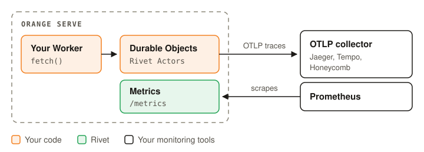

# OpenTelemetry and Prometheus

Each Durable Object runs as a Rivet Actor, so Rivet's traces, metrics, and logs cover your
objects. You turn them on with environment variables, and your code does not change.

<picture>
  <source media="(prefers-color-scheme: dark)" srcset="../images/monitoring-dark.svg" />
  
</picture>

## Quickstart

You need a Rivet Cloud cluster and an OTLP collector, such as Jaeger, Tempo, or Honeycomb.

<Steps>

<Step title="Send traces to your collector">

```sh
orange deploy \
  --var OTEL_SERVICE_NAME:my-app \
  --var OTEL_EXPORTER_OTLP_TRACES_ENDPOINT:https://collector.example.com/v1/traces
```

</Step>

<Step title="Find an object's spans">

Each request and RPC call to a Durable Object is one span. Its `rivet.actor.key` is the
object's ID.

</Step>

<Step title="Open metrics and logs">

On Rivet Cloud these need no setup. The Rivet dashboard shows your cluster's metrics, and its
Logs page shows your Worker's output.

</Step>

</Steps>

## Try it locally

`orange dev` reads the same variables from your shell.

```sh
export OTEL_SERVICE_NAME=my-app
export OTEL_EXPORTER_OTLP_TRACES_ENDPOINT=https://collector.example.com/v1/traces
orange dev
```

## Self-host

Pass the same variables to the container. Set `RIVETKIT_METRICS_PORT` to serve Prometheus
metrics, and scrape them from a sidecar in the same pod.

```sh
docker run \
  -e OTEL_SERVICE_NAME=my-app \
  -e OTEL_EXPORTER_OTLP_TRACES_ENDPOINT=https://collector.example.com/v1/traces \
  -e RIVETKIT_METRICS_PORT=9464 \
  -e RIVET_ENDPOINT=... my-worker
```

## Learn more

- [OpenTelemetry](https://rivet.dev/docs/tracing/): span names, sampling, and application spans
- [Performance monitoring](https://rivet.dev/actors/docs/performance-monitoring/): PromQL for actors and SQLite
- [Logging](https://rivet.dev/actors/docs/logging/): log levels and formats

<AiContext summary="Spans, metrics, and log output in detail">

#### Traces

- With an OTLP endpoint set, RivetKit exports a span for each Durable Object request and RPC
  call, with the SQLite work inside it. The Worker's own handlers get no spans.
- Each span carries `rivet.actor.name`, which is the class in kebab case and a short hash, such
  as `greeter-5c8cd02c`, and `rivet.actor.key`, which is the object's ID.
- `--var` also puts the variable in the Worker's `env`. See
  [Variables and secrets](../deploy#variables-and-secrets).
- If the collector needs an API key in `OTEL_EXPORTER_OTLP_HEADERS`, pass it with
  `--secrets-file`, not `--var`.

#### Metrics

RivetKit serves Prometheus metrics at `http://127.0.0.1:$RIVETKIT_METRICS_PORT/metrics`.

- **Rivet Cloud** sets `RIVETKIT_METRICS_PORT` on each runner, collects the metrics, and shows
  them in the Rivet dashboard. `orange deploy` refuses to set it with `--var`.
- **Self-hosted:** the endpoint listens on `127.0.0.1` only, so `docker run -p` does not expose
  it. Scrape it from the same network namespace, such as a sidecar in the same Kubernetes pod.
- `orange dev` serves no metrics.
- With several Workers, only the first Worker's runtime serves metrics, so they cover that
  Worker's objects only.

| Metric | What it shows |
|---|---|
| `rivet_rivetkit_actor_active_count` | Awake actors, by `actor_name` |
| `rivet_rivetkit_actor_http_requests_active` | Requests and RPC calls in progress |
| `rivet_rivetkit_actor_inbox_depth` | Work waiting to run |

#### Logs

- `orange dev` prints each request and your Worker's `console` output.
- `orange serve` prints the `console` output and RivetKit's warnings and errors.
- Self-hosted, read the container's output.
- Set `RIVET_LOG_LEVEL=info` to add RivetKit's info logs.

</AiContext>
